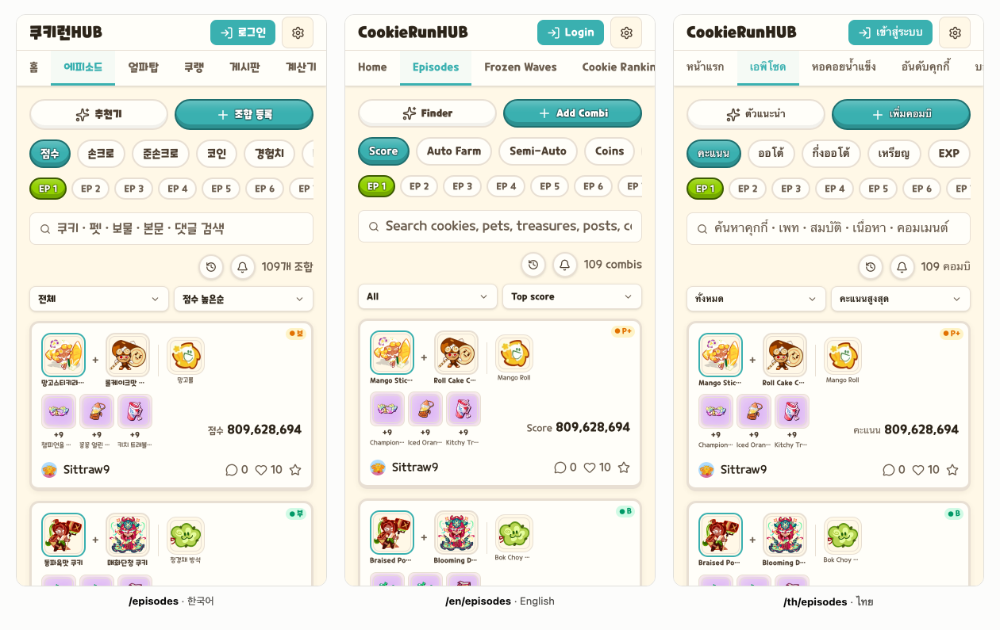

# CookieRunHUB

쿠키런의 조합과 공략을 찾아 비교하고 공유하는 게임 정보 서비스.
혼자 설계·개발·운영하고 있으며, 한국어·영어·태국어를 지원한다.

[서비스 열기](https://www.cookierunhub.com)

- **성격:** 개인 서비스 · 공개 개발 기록
- **주요 작업:** 웹·API·DB 개발 · 다국어 처리 · 자택 서버 배포·운영
- **기술:** Next.js · React · FastAPI · PostgreSQL · Docker · Caddy

같은 조합 페이지의 세 언어 화면. 사용자 게시글과 조합 이름도 번역한다.

## 프로젝트 개요

- 게임 조합과 공략을 탐색하고 비교한다.
- 사용자가 작성한 조합·게시글을 여러 언어로 제공한다.
- 반응형 웹과 Android·iOS 클라이언트로 접근한다.

이 저장소에는 서비스 코드·데이터 대신 공개할 수 있는 구조와 운영 경험을 정리했다.

## 구현 내용

프런트엔드·백엔드·데이터베이스와 자택 리눅스 서버의 배포·운영을 직접 맡았다.
서비스를 계속 운영하면서 특히 다음 부분을 다뤘다.

| 주제 | 내용 |
| --- | --- |
| 배포·복구 | 새 버전을 대기 슬롯에서 확인하고 전환하는 blue-green 배포, 상태 점검과 자동 복구 |
| 다국어 | 사용자 콘텐츠의 원문·번역본 관리와 백그라운드 번역 처리 |
| 서버 자원 | 웹·API의 캐시를 나누고 변경된 데이터에 맞춰 무효화 |

세부 설계와 당시 코드 규모는 [개발·운영 기록](docs/engineering-notes.md)에 있다.

## 운영 결과

기존 Google Analytics 자료의 집계 구간은 **2026-05-10 ~ 2026-08-30**이다.
아래 값은 당시 기록이며 현재 실시간 지표가 아니다.

| 지표 | 기록 |
| --- | --- |
| 월 활성 사용자 | 약 14만 명 |
| 구간 누적 활성 사용자 | 약 27만 명 |
| 활성 사용자당 평균 참여 시간 | 18분 02초 |

<picture>
  <source media="(prefers-color-scheme: dark)" srcset="docs/images/top-pages-dark.svg">
  
</picture>

영어·태국어 페이지의 이용 기록. [상세 통계](docs/usage-metrics.md)에 집계 구간과 원래 표를 함께 남겼다.

## 문서

| 문서 | 내용 |
| --- | --- |
| [시스템 구조](docs/architecture.md) | 클라이언트·API·데이터베이스 구성 |
| [배포와 복구](docs/deployment.md) | 배포, 상태 점검, 장애 대응 |
| [다국어와 검색](docs/i18n-seo.md) | 콘텐츠 번역, 언어별 경로와 검색 메타데이터 |
| [개발·운영 기록](docs/engineering-notes.md) | 설계 결정과 당시 코드 규모 |
| [상세 이용 기록](docs/usage-metrics.md) | 유입·언어별 이용·재방문·수익 자료 |

## 공개 범위

코드·데이터베이스·수집 데이터는 공개하지 않는다. 이 저장소는 실행용 코드가 없는 문서 저장소다.
운영 방식과 수치는 문서에 적힌 시점의 기록이며 이후 변경 사항이 모두 반영된 것은 아니다.

## 관련 프로젝트

[쿠키런 크리스탈 계산기](https://github.com/sesepark/cookierun-crystal)에도 HUB 연동과
저장·예외 처리 기능을 기여했다. 해당 변경은 원본 프로젝트에 병합됐다.
