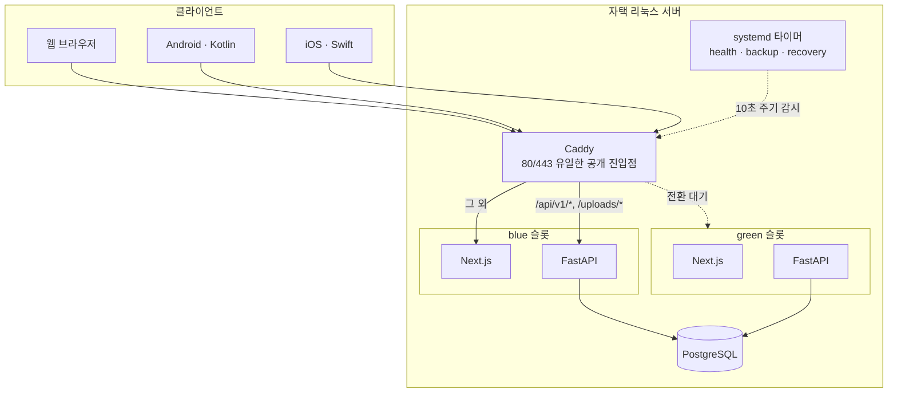
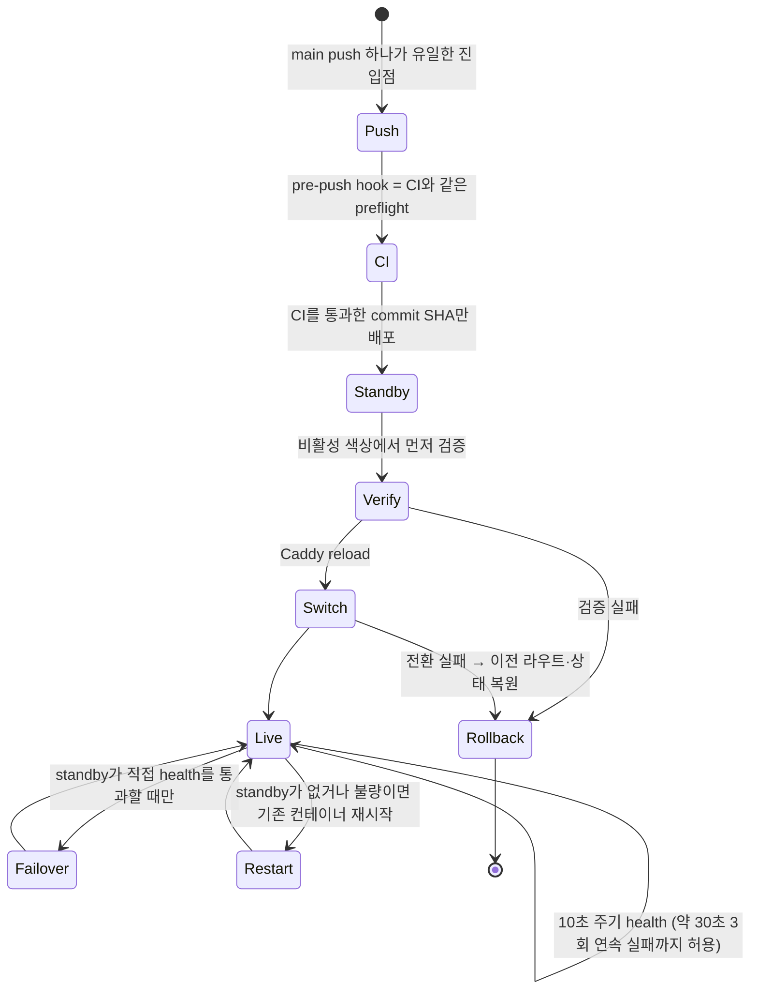

# CookieRunHUB 개발·운영 기록

[프로젝트 소개](../README.md)

코드 규모는 2026-09-06 기준 기록이다. 아래 설명도 당시 운영 자료를 정리한 것이다.

## 코드 규모

| 항목 | 값 |
|---|---|
| 개발 기간 | 2026-02 ~ 2026-09 기록 (단독 개발) |
| 커밋 | 728 |
| 코드 | TypeScript/TSX 약 13.3만 줄, Python 약 8만 줄, Kotlin 1.2천 줄, Swift 0.7천 줄 |
| 백엔드 도메인 모듈 | 31개 |
| DB 마이그레이션 | 156개 |
| 지원 언어 | 한국어 · 영어 · 태국어 |
| 클라이언트 | 웹(반응형) · Android · iOS |

## 아키텍처



라우팅 규칙에 함정이 하나 있음. `/api/*` 를 통째로 FastAPI로 넘기면 안 됨. `/api/revalidate` 를
비롯한 몇몇 경로는 Next.js Route Handler이기 때문임.

```
/api/v1/*  → FastAPI
/uploads/* → FastAPI
/api/*     → Next.js Route Handler
그 외      → Next.js
```

## 기술적으로 신경 쓴 것들

### 1. 무중단 배포와 자동 복구를 직접 구현

관리형 PaaS가 아니라 자택 서버라, 배포 파이프라인과 장애 복구를 전부 직접 만들어야 했음.



- 배포 진입점은 **`main` push 하나뿐**임. 운영 체크아웃은 실행 전용이고 항상 clean을 유지하며,
  서버에서 고칠 일이 있으면 별도 worktree에서만 함.
- CI를 통과한 **정확한 commit SHA만** 배포함. push 전에 `.githooks/pre-push`가 CI와 동일한
  `scripts/preflight.sh --all` 을 돌리고, hook을 우회해도 GitHub Actions가 같은 검사로 막음.
- 새 버전은 **비활성 색상에서 먼저 검증**한 뒤 Caddy를 reload해 전환함. 전환에 실패하면 이전
  라우트와 배포 상태를 즉시 되돌림.
- 이전 버전은 전환 후 **30분간 standby**로 살려 둠.
- **10초 주기 health 타이머**(`cookierunhub-health-recovery.timer`)가 active 경로를 감시함. 약
  30초 동안 3회 연속 실패하면 standby가 직접 health를 통과할 때만 그쪽으로 전환하고, standby가
  없거나 불량이면 기존 컨테이너를 재시작해 라우트를 복구함. 배포 도중 중단되어 상태가
  `switching`이면 기록된 이전 active로 되돌림.
- 복구기는 **새 이미지를 임의로 만들지 않음.** 기록된 컨테이너가 없으면 조용히 넘어가지 않고
  명시적으로 실패함. 배포 lock이 잡혀 있는 동안에는 손대지 않고 다음 주기에 재시도함.

→ 자세히: [docs/deployment.md](../docs/deployment.md)

### 2. 3개국어를 "번역 파일"이 아니라 파이프라인으로

정적 문구뿐 아니라 **사용자가 작성한 게시글까지** 번역 대상임. 그래서 로케일 문자열 파일이
아니라 DB 스키마와 백그라운드 워커가 필요했음.

- 콘텐츠마다 원본 로케일(`source_locale`)을 기록하고, 번역본은 별도 테이블에 둠.
- 번역 워커가 큐를 소비하며, 외부 API quota를 고려해 처리량을 조절함.
- 폴백 순서가 언어마다 다름. 영어 UI는 한국어로, 태국어 UI는 영어 → 한국어 순으로 내려감.
- 로케일별 라우트(`/`, `/en/*`, `/th/*`)를 두고 canonical과 hreflang을 맞춤.

→ 자세히: [docs/i18n-seo.md](../docs/i18n-seo.md)

### 3. 캐시를 한 겹이 아니라 계층으로

자택 서버라 CPU·메모리·대역폭·외부 API 비용이 전부 실제 제약임. 그래서 "일단 캐시" 대신 어느
계층에서 무엇을 무효화할지를 규칙으로 정해 두었음.

- Next.js ISR/revalidation과 API 응답 캐시를 분리해 다룸.
- 무효화는 **이벤트 기반**임. 넓게 쓸어버리는 무효화를 금지하고, 바뀐 것만 지움.
- 요청 중복 제거(dedup)를 두어 같은 데이터를 여러 컴포넌트가 각자 부르지 않게 함.
- 누적 통계(예: 조합 동시조회 통계)는 갱신 경로를 따로 관리함.

### 4. 변경 이력을 코드와 같은 커밋에 강제

사용자에게 보이는 변경은 반드시 같은 커밋에서 3개 국어 changelog에 기록하도록 규칙을 정해
두었음. 관리자·운영자 전용 변경은 플레이어용 changelog에서 제외함. 사람이 나중에 손으로 채우는
방식은 반드시 밀리기 때문임.

### 5. 자택 서버 보안 경계

- 공개 포트는 Caddy의 80/443 **뿐**임. PostgreSQL과 관리 서비스는 절대 외부로 열지 않음.
- 비밀값은 저장소에 넣지 않고 `.env`로만 다룸.
- 마이그레이션·복구 중에는 `STARTUP_MUTATIONS_ENABLED`, `STARTUP_BACKGROUND_TASKS_ENABLED`를
  꺼서 시작 시 부작용을 차단하는 안전 모드를 둠.
- 백업은 systemd 타이머로 자동화하고, 오프사이트 사본을 따로 둠.

## 백엔드 구조 규칙

기능마다 같은 모양을 유지함. 라우터에 SQL이나 업무 규칙을 직접 넣지 않음.

```
src/<domain>/
  models.py   데이터 모델
  schemas.py  요청/응답 Pydantic 모델
  service.py  업무 규칙과 DB 접근
  router.py   HTTP 엔드포인트
```

`auth`, `board`, `combinations`, `calculator`, `game_data`, `favorites`, `friend_codes`,
`ice_tower`, `notifications`, `recommender`, `translations` 등 31개 도메인이 이 규칙을 따름.

→ 자세히: [docs/architecture.md](../docs/architecture.md)
