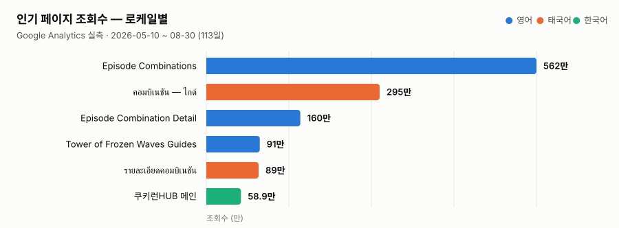
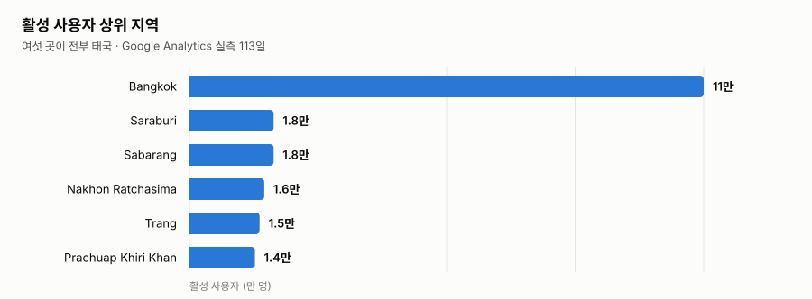

# CookieRunHUB 이용 기록

[프로젝트 소개](../README.md)

이 문서는 기존 분석 자료를 옮긴 기록이다. 현재 지표를 뜻하지 않는다.

## 실제 이용

Google Analytics 실측임. 구간은 **2026-05-10 ~ 2026-08-30 (113일)**.

| 항목 | 값 |
|---|---|
| 월 활성 사용자 (MAU) | **14만 명** |
| 주 활성 사용자 (WAU) | 5.1만 명 |
| 일 활성 사용자 (DAU) | 1.3만 명 |
| 구간 누적 활성 사용자 | 27만 명 |
| 이벤트 | 2,609만 |
| 활성 사용자당 평균 참여 시간 | **18분 02초** |
| 활성 사용자당 참여 세션 수 | 5.8회 |

18분이라는 체류 시간이 이 서비스의 성격을 가장 잘 설명함. 읽고 나가는 정보 페이지가 아니라
조합을 찾고 비교하고 저장하는 도구라, 한 번 들어오면 오래 머무름.

### 이용자 추이와 재방문

활성 사용자는 6월 말까지 거의 0에 가까웠음. 7월에 검색 유입이 걸리기 시작하면서 가파르게
올랐고, 8월에는 일 활성 1~2만 명대에서 유지되고 있음. 광고를 집행한 적은 없음.

| 재방문 지표 | 값 | 뜻 |
|---|---|---|
| WAU / MAU | **35.3%** | 한 달 안에 들어온 사람 셋 중 하나가 그 주에도 들어옴 |
| DAU / WAU | 26.2% | 그 주 이용자의 네 명 중 한 명꼴이 하루 안에 다시 옴 |
| DAU / MAU | **9.2%** | 서비스가 얼마나 습관이 되었는가 |

한 번 쓰고 마는 서비스가 아니라는 것이 이 세 숫자에 들어 있음. 활성 사용자당 참여 세션이
5.8회라는 것도 같은 이야기임 — 한 사람이 평균 여섯 번 가까이 다시 열었음.

### 3개국어가 실제로 쓰이는가

만들어 둔 것과 쓰이는 것은 다름. 인기 페이지 상위 여섯 가운데 둘이 태국어이고, 그 둘의 조회수
합이 384만임.

<picture>
  <source media="(prefers-color-scheme: dark)" srcset="../docs/images/top-pages-dark.svg">
  
</picture>

활성 사용자 상위 지역은 더 분명함. **여섯 곳이 전부 태국임.**

<picture>
  <source media="(prefers-color-scheme: dark)" srcset="../docs/images/regions-dark.svg">
  
</picture>

번역을 로케일 문자열 파일이 아니라 DB 스키마와 백그라운드 워커로 만든 판단
([다국어 처리](i18n-seo.md))이 값을 한 자리임.

### 무슨 일이 일어나는가

| 이벤트 | 수 |
|---|---|
| page_view | 1,664만 |
| ad_impression | 471만 |
| session_start | 208만 |
| scroll | 117만 |
| user_engagement | 110만 |
| first_visit | 27만 |
| click | 12만 |

세션 208만 회에 페이지뷰 1,664만 — 세션당 8쪽 가까이 넘겨 봄. 조합 하나를 정하려고 여러 개를
열어 비교하는 사용 방식이 그대로 드러남.

### 어디서 들어오는가

| 세션 소스 / 매체 | 세션 수 |
|---|---|
| google / organic | 102만 |
| (direct) / (none) | 83만 |
| accounts.google.com | 6.3만 |
| youtube.com / referral | 6.3만 |
| l.facebook.com / referral | 2.5만 |
| bing / organic | 2.4만 |

검색 유입이 가장 큰 단일 경로임. 광고를 집행하지 않으므로 로케일별 라우트와 canonical·hreflang
설정이 그대로 유입으로 돌아옴.

### 인기 페이지

| 페이지 | 조회수 | 활성 사용자 | 이탈률 |
|---|---|---|---|
| Episode Combinations (en) | 562만 | 13만 | 16.0% |
| คอมบิเนชัน — ไกด์ (th) | 295만 | 8.7만 | 15.3% |
| Episode Combination Detail (en) | 160만 | 9.8만 | 11.6% |
| Tower of Frozen Waves Guides (en) | 91만 | 5.4만 | 17.9% |
| รายละเอียดคอมบิเนชัน (th) | 89만 | 7만 | 14.4% |
| 쿠키런HUB 메인 (ko) | 58.9만 | 9.1만 | 6.2% |

메인 페이지 이탈률 6.2%는 조합 목록·상세로 이어지는 동선이 실제로 작동한다는 뜻임.

### 수익

| 항목 | 값 |
|---|---|
| 일 평균 광고 수익 | **$9.85** |
| 전자상거래 수익 | $0.00 (결제 기능 없음) |

2026-08-09 ~ 08-29 21일간 광고 수익 $206.92를 일수로 나눈 값임. 누적으로 적지 않는 이유는 광고를
붙이기 전인 6월까지가 함께 섞여 지금 속도를 실제보다 낮게 보이게 하기 때문임. 전액 광고
수익이고, 이용자에게 직접 돈을 받지 않음.

규모 자체는 크지 않지만, 트래픽을 받는 것과 그 트래픽으로 운영을 지탱하는 것은 다른 문제라
여기에 함께 적어 둠.
